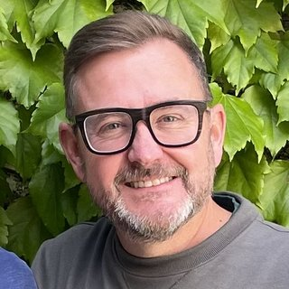

I'm a Senior Product Designer and Design Engineer with 25 years across design and software development. I'm as interested in how products work as in how they look and feel, and I do my best work close to engineering teams.

<!-- excerpt -->

## How I got here

I studied Engineering Design Visualisation at Bournemouth University, and my first jobs were as much about code as design. At Infolook Multimedia I introduced ASP scripting so we could offer clients dynamic websites they could manage themselves. At Ardent Creative I worked across the full stack, designing and building client sites, and at Designate I combined interactive design with front-end development for clients including P&O Ferries and Best Western. Our Wales in Style website won Best Agency for Website Design at the 2007 Travolution Awards.

At First Choice I designed for the main holiday booking site and introduced progressive enhancement to load live pricing from a JSON API onto deals and landing pages.

From there I moved into UX leadership. At TUI I led a team of three to five designers through a multi-million-pound e-commerce re-platform, with a lot of research, usability testing and conversion work along the way. At Click Travel I was the only designer supporting seven engineering teams, evolving the pattern library alongside front-end engineers. As Head of UX at Auderli I took a startup from idea to paid MVP in six sprints, and designed and built its marketing site in Gatsby and React.

Most recently I led hands-on UX design on a large financial services programme, where I used Claude to build functional prototypes that showed complete customer journeys, interaction logic included.

## What I believe

The best digital products come from bringing design and engineering closer together. I enjoy getting to grips with complex products, understanding customer and business needs, and turning them into coherent, usable experiences, then seeing them through to code.

AI is changing what it means to be a product designer. Tools like Claude let me move beyond static designs: exploring interactions, working through the logic of complex experiences and testing ideas far more realistically. I see that as a way to shorten the distance between design and implementation, not as a replacement for either discipline.

## Where I've worked

B2B SaaS, fintech, enterprise software and e-commerce, from bootstrapped startups to programmes with six engineering teams and 100+ stakeholders.

## Outside work

I love wild, wide open spaces: mountains, rivers and woodland are my go-to places. For around six years my family and I lived in rural France, in search of deep work and space for our children to grow up multilingual. We're now back in the UK, in Dorset.

Curating a natural space (aka gardening) has become more important to me over the years, as has improving my cooking. Yes, I love food.




I'm a lifelong learner with a growth mindset, always trying new things. Aesthetically I'm drawn to modernism and minimalism, and also to wabi-sabi, with a fascination for mixing nature and modernity.

I also volunteer, most recently rebuilding the website for Aide et Espoir, an Anglo-French charity helping children and families affected by war and conflict.
